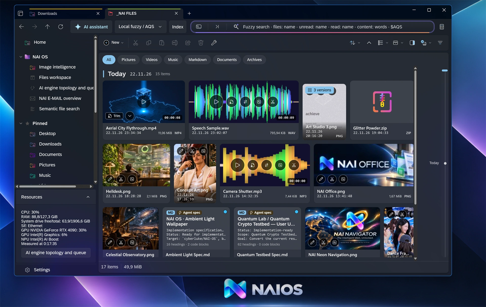

# NAI Files

NAI Files is a personal WinUI 3 file manager for **NAI OS**, built around a
media-first Pulse view, local AI and vision, fuzzy search, and native NAI OS
integration.

> NAI Files is a personal project. It is not affiliated with Microsoft.

<p align="center">
  <a href="https://github.com/cyberluke/NAI-Files">Source</a> ·
  <a href="https://updates.nanotrik.ai/NAI-Files/NAI-Files.appinstaller">Download</a> ·
  <a href="https://revolut.me/lukalita">Donate</a> ·
  <a href="#license">License</a>
</p>

<p align="center">
  
</p>

## Why NAI Files

### Pulse view

A chronological, time-railed feed for media folders. Cards show real
thumbnails, inline video playback with trim, audio waveforms and playback,
image crop/rotate/convert actions, archive previews, and Markdown agent-spec
cards with status, scope and structure.

Tabs, filter chips (All, Pictures, Videos, Music, Markdown, Documents,
Archives), version stacks, and the day timeline keep large folders navigable.

### Pulse is the default for media folders

- A manual per-folder layout choice always wins and is remembered.
- Pictures and Videos open in Pulse.
- Any folder with an image, video or audio file opens in Pulse.
- A folder with no media stays in the default details view.

The decision is re-evaluated on navigation while the folder follows the adaptive
default; changing the layout from the toolbar pins that folder.

### AI assistant and providers

- Toolbar AI assistant for chat and image work.
- Pluggable providers: LUSI Engine (local), Kelvin AI Workstation, and
  OpenAI-compatible gateways.
- Per-capability routing for chat, vision and embeddings.
- Local NPU/GPU lanes are preferred; provider and model routing is configurable.

### Fuzzy search and AQS

- Instant local fuzzy search from the toolbar (`Local fuzzy / AQS`).
- AQS filters: `files:`, `unread:`, `read:`, `content:`, plus `$AQS`.
- Index status is visible in the toolbar.

### Pictures with AI

Image intelligence analyzes pictures and lets you search by visible content,
captions, OCR and tags.

- Typing searches the local analysis cache; folder analysis requires explicit
  approval.
- Analysis uses the explicitly selected model through the paired AI engine:
  LUSI Engine first, Kelvin AI Workstation as fallback, with no automatic cloud
  fallback.
- Saved semantic searches (lenses), related images, shared AI tags, cached
  duplicate detection, and cross-language search.

### Semantic file search

Meaning-based search over files using NAI Lattice vectors and LUSI embeddings,
running locally and reachable from the NAI OS sidebar.

### NPU and GPU

- Local AI work prefers the machine's NPU/GPU lanes and falls back according to
  the selected provider.
- The Resources panel shows live CPU, RAM, disk, network, GPU and NPU telemetry.
- NAI Media Lab probes the bundled FFmpeg for the filters and encoders the
  machine supports.

### NAI Media Lab

46 FFmpeg 9 operations for video, audio and images: convert, trim, split,
compress, HDR-to-SDR tonemap, extract frames and GIFs, contact sheets, audio
normalize and denoise, and more. Operations run locally and write sibling
outputs with cancellable progress.

### NAI OS integration

- Follows the NAI OS language by default; per-app override in Settings →
  General.
- NAI theme, SAP 72 font and rainbow folder icons.
- NAI OS workspaces in the sidebar: Image intelligence, Files workspace,
  AI engine and queue, NAI E-MAIL overview, and Semantic file search.
- Live Resources panel for the machine's CPU, RAM, GPU and NPU.

### The file manager underneath

Tabs, panes, tags, archives, FTP/SFTP, Git status, the preview pane, batch
rename, and the rest of the file manager feature set remain available.

## Install

NAI Files is distributed as a signed MSIX and built from source. It is not on
the Microsoft Store. Updates come from the signed NAI Files feed through
Windows App Installer and the in-app updater.

[](https://updates.nanotrik.ai/NAI-Files/NAI-Files.appinstaller)

1. Install the signed package from
   [updates.nanotrik.ai](https://updates.nanotrik.ai/NAI-Files/NAI-Files.appinstaller),
   or build it below.
2. Trust the certificate used to sign the package.
3. Install a built package:

```powershell
Add-AppxPackage -Path .\NAI-Files_<version>_x64.msixbundle
```

## Build from source

### Prerequisites

- Windows 10 2004 (10.0.19041) or newer; Windows 11 recommended.
- .NET SDK **11.0.100-rc.3** (pinned in `global.json`); NuGet restore brings the
  Windows App SDK and WinUI 3 packages.
- Visual Studio 2022 with the WinUI/Windows App SDK components is optional when
  using the `dotnet` CLI.
- For packaging: Windows SDK 10.0.26100 (`makeappx`, `signtool`) and a trusted
  code-signing certificate.

### Build the app

```powershell
dotnet build src/Files.App/Files.App.csproj -c Debug -p:Platform=x64 -v:quiet -clp:ErrorsOnly
```

Use `-p:Platform=arm64` for ARM64.

### Build an MSIX

```powershell
dotnet build src/Files.App/Files.App.csproj -c Debug -p:Platform=x64 `
  -p:AppxBundle=Never -p:GenerateAppxPackageOnBuild=true `
  -p:AppxPackageDir=artifacts/AppxPackages/
```

Sign the produced `.msix` with your certificate, then `Add-AppxPackage` it.

## Repository layout

- `src/Files.App` — WinUI 3 app: Pulse, Media Lab, AI, NAI workspaces, shell and
  settings.
- `src/Files.App.Controls`, `Files.App.Storage`, `Files.App.CsWin32` — shared
  controls, storage abstractions and native interop.
- `tests/` — interaction, UI and unit test projects.
- `.github/` — workflows and community documents.
- `AGENTS.md` — development and agent guidelines.

## Contributing

- Bugs and feature requests:
  [issues](https://github.com/cyberluke/NAI-Files/issues)
- Guidelines: [CONTRIBUTING.md](CONTRIBUTING.md)
- Security: [SECURITY.md](SECURITY.md)
- Code of conduct: [CODE_OF_CONDUCT.md](CODE_OF_CONDUCT.md)

## ❤️ Support Independent Development

NAI Files is independently developed and open source.

If you enjoy my projects and would like to support their continued development, voluntary donations are always appreciated.

[☕ Donate via Revolut](https://revolut.me/lukalita)

<a href="https://revolut.me/lukalita">
  
</a>

Scan the QR code or use the link above to make a one-time donation.

Every contribution helps. Thank you for your support! 🧪

## License

NAI Files is distributed under the MIT license (`LICENSE-MIT`); some components
are under the MPL (`LICENSE-MPL`). Third-party notices are in
[NOTICE.md](NOTICE.md).
